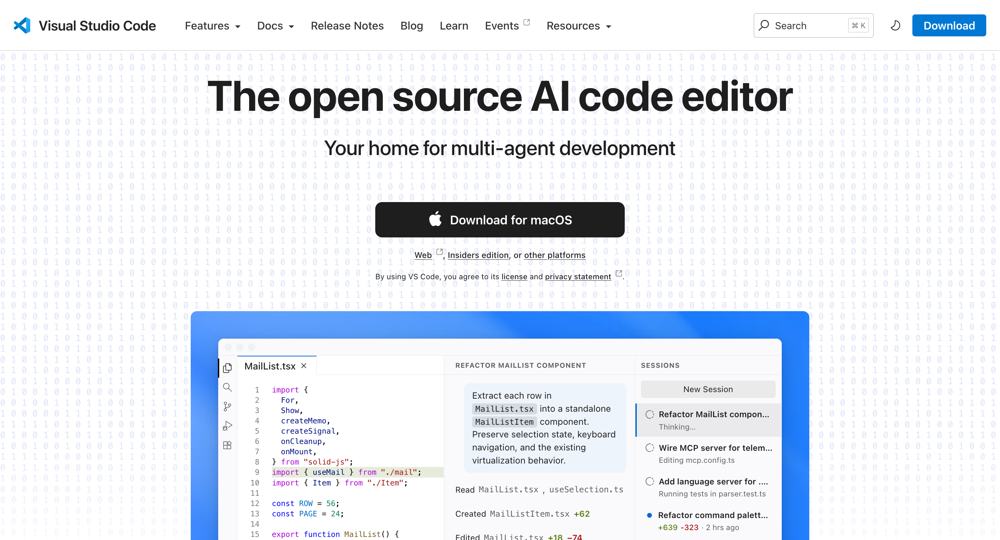
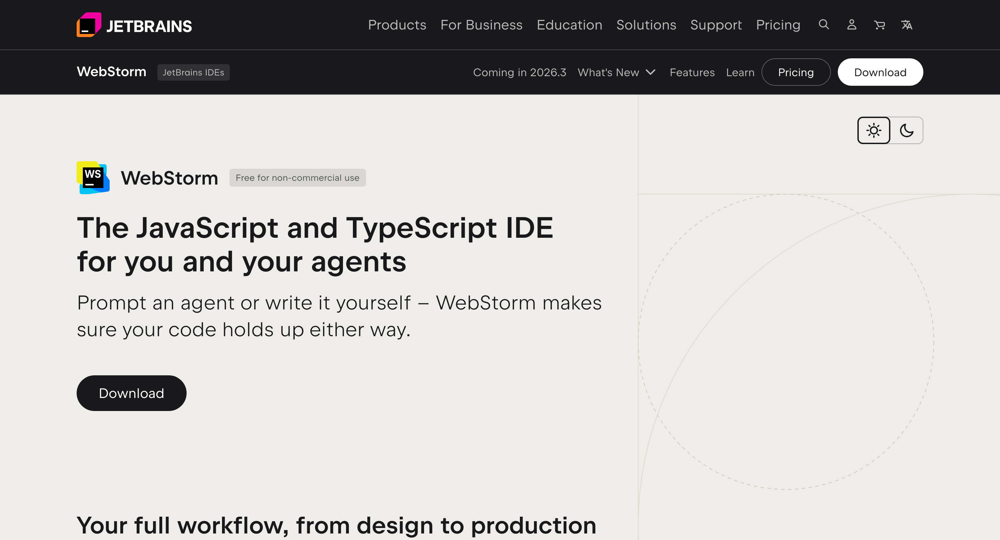
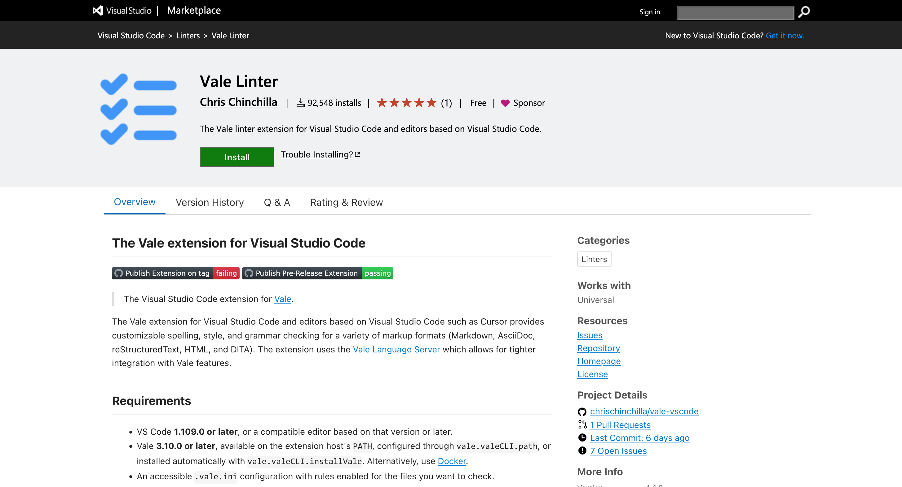
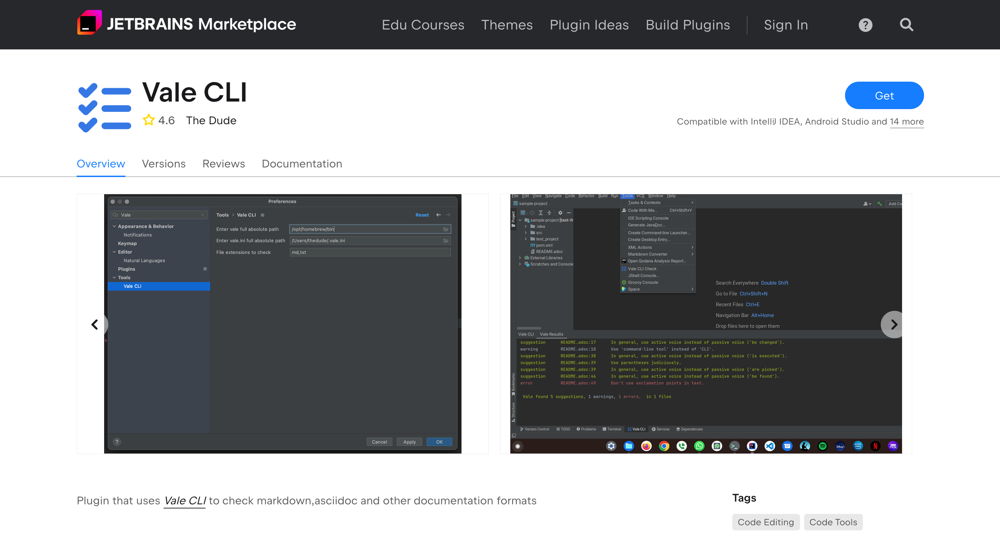
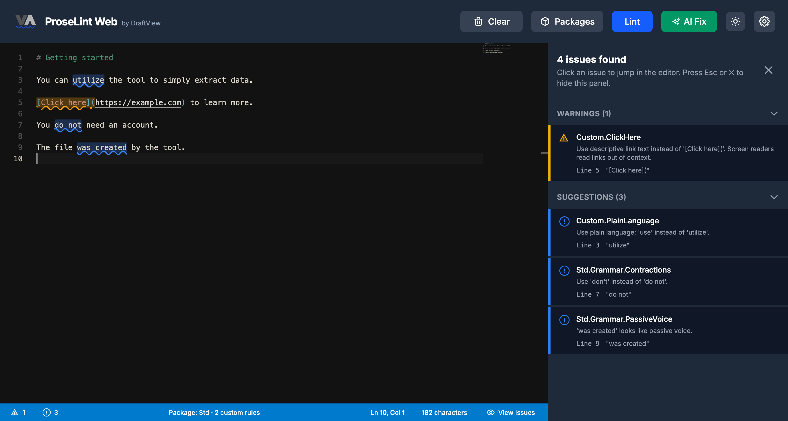
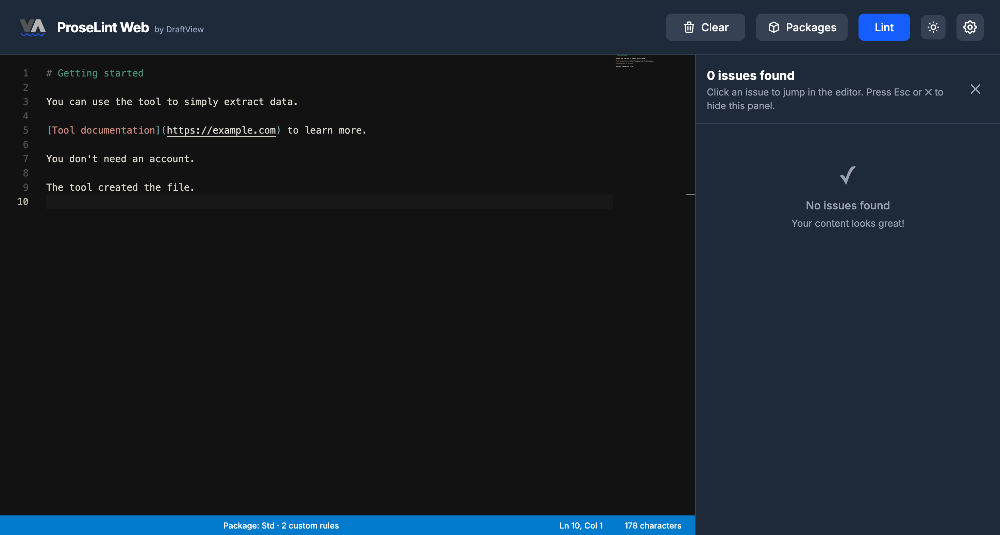
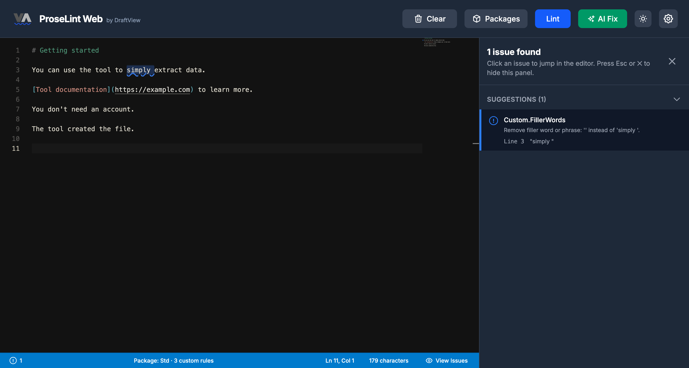

# Linting for everyone

## Linters for prose

**Vale** checks writing against our style guide; **markdownlint** keeps Markdown clean.

Both tools work in your editor, CI, or agent workflow.

---

## Writing can look finished

Before we’ve finished thinking.

A familiar sentence can carry assumptions we didn’t choose.

**What can we check automatically?**

---

## We already had guardrails

Before AI agents became everyday tools, we relied on linters.

**We still do.**

They check the rules we agree on and give us consistent feedback.

---

## Deterministic, maybe even to a fault

- The same text, rules, and tool version give the same findings.
- Checks don’t invent new diagnoses.
- False positives repeat, too.

**People still choose the rules and judge the writing.**

---

## Two tools, one Markdown file

Markdown is readable plain text with headings, lists, links, and code.

| Tool | Main job | Example |
| --- | --- | --- |
| Vale | Configured prose and style rules | “apify console” → <br>“Apify Console” |
| markdownlint | Markdown structure and conventions | A heading skips a level |

<small>[docs.vale.sh](https://docs.vale.sh/) / [github.com/DavidAnson/markdownlint](https://github.com/DavidAnson/markdownlint) / [markdownguide.org/getting-started](https://www.markdownguide.org/getting-started/)</small>

---

## markdownlint: make structure visible

Before:

```markdown
# Getting started
### How to set up the tool
```

After:

```markdown
# Getting started
## How to set up the tool
```

<small>MD001: heading levels should only increment by one level at a time.</small>

---

## Vale: a style guide that gives feedback

These checks reflect **Apify’s** editorial decisions.

| Our guidance | Before | Suggested revision |
| --- | --- | --- |
| Use official product names | apify console | Apify Console |
| Use input-neutral instructions | Click on the Run button. | Select the Run button. |
| Make links descriptive | here | Apify Store |

<small>Apify Vale styles: [github.com/apify/vale-rules](https://github.com/apify/vale-rules)</small>

---

## Some rules ask a question

> Our scraper extracts leads instantly.

<small>`ApifyContent.UnverifiedPromise`</small>

> Possible claim-mismatch: ‘instantly’: verify this matches the actual user experience.

**Keep it, qualify it, or rewrite it — based on evidence.**

---

## Readability is another useful signal

- Vale can flag prose above a chosen reading grade.
- Use the result to review wording and sentence length.
- A score can’t tell you whether readers understand.

**Write for people with different levels of English.**

<small>[docs.vale.sh/checks/readability](https://docs.vale.sh/checks/readability)</small>

---

## The same checks, wherever you write

**Commit the rules so people and agents share the same checks.**

| Place | Feedback loop |
| --- | --- |
| VS Code / WebStorm | Write → see findings → revise |
| CI | Push → run checks → review findings |
| Claude Code | Draft → run CLI → inspect findings → revise → rerun |

<small>[github.com/vale-cli/vale-action](https://github.com/vale-cli/vale-action) / [github.com/DavidAnson/markdownlint-cli2-action](https://github.com/DavidAnson/markdownlint-cli2-action)</small>

---

<!-- _class: screenshot -->

## VS Code



<small>A code editor with Markdown editing and preview. [code.visualstudio.com](https://code.visualstudio.com)</small>

---

<!-- _class: screenshot -->

## WebStorm



<small>An IDE for web development with Markdown editing and preview. [jetbrains.com/webstorm/](https://www.jetbrains.com/webstorm/)</small>

---

<!-- _class: editors -->

## Bring Vale into your editor

 

<small>Vale in VS Code: [marketplace.visualstudio.com](https://marketplace.visualstudio.com/items?itemName=ChrisChinchilla.vale-vscode) / Vale in WebStorm: [plugins.jetbrains.com](https://plugins.jetbrains.com/plugin/19613-vale-cli)</small>

---

## Start with rules people trust

1. Agree on a few useful checks.
2. Test real drafts and review noise and exceptions together.
3. Pin versions and make only trusted checks block a merge.

<small>With Vale’s CLI, error findings return a failing exit status.</small>

**Use the findings to improve your style guide.**

---

## Give the agent a checkable task

The workflow must actually run the checks.

```text
Revise this Markdown draft using our project style guide.
Run Vale and markdownlint with the project configuration.
Fix clear issues and rerun both tools.
Preserve meaning, facts, links, and code examples.
Flag suggestions that need editorial judgment or evidence.
Show the diff and remaining findings for human review.
```

**The agent revises. The tools check. A person decides.**

---

<!-- _class: screenshot -->

## Start with Vale Std


<small>2 Std suggestions: “do not” → “don’t” / “was created” → consider active voice.</small>

---

<!-- _class: screenshot -->

## Add our style guide



<small>4 findings. Our rules add “utilize” → “use” and descriptive link text.</small>

---

<!-- _class: screenshot -->

## Revise, then check again



<small>Zero findings with these checks. Is the writing finished?</small>

---

<!-- _class: screenshot -->

## One more rule, one more question



<small>“Simply” adds nothing here and can make the task sound easy for everyone.</small>

---

<!-- _class: screenshot -->

## Keep the meaning. Remove the filler.


<small>“You can use the tool to extract data.” All enabled checks pass.</small>

---

## A rule is a small, readable agreement

Use official product names.

<small>`Apify.ApifyProductNames`: excerpt</small>

```yaml
extends: substitution
message: "Use the Apify product name '%s' instead of '%s'."
ignorecase: true
level: warning
scope:
  - summary
  - heading
vocab: false
swap:
  'apify console': Apify Console
```

---

## A regex can express a writing rule

Use descriptive link text. Screen readers read links out of context.

<small>`Apify.ClickHere`</small>

```yaml
extends: existence
message: >-
  Use descriptive link text instead of '%s'.
  Screen readers read links out of context.
level: warning
scope: raw
nonword: true
tokens:
  - '\[(?:[Cc]lick here|[Hh]ere|[Tt]his link|[Rr]ead more)\]\('
```

<small>`[here](https://apify.com/store)` → `[Apify Store](https://apify.com/store)`</small>

---

## A clean lint run still needs review

- Zero findings means the **enabled checks** passed.
- Findings and suggested fixes still need judgment.
- Clean drafts can still contain unsupported claims.

**Review the writing. Improve the rules, too.**

---

<!-- _class: screenshot -->

## Keep linters in your agent workflow


<small>Setup, fixes, triage, vocabulary, and CI. [vale.sh/skills](https://vale.sh/skills)</small>

---

<!-- _class: resources -->

## Resources: try it in your workflow

| Start here | Explore further |
| --- | --- |
| [docs.vale.sh/topics/quickstart](https://docs.vale.sh/topics/quickstart) | [vale.sh/explorer](https://vale.sh/explorer) / [vale.sh/generator](https://vale.sh/generator) |
| [proselintweb.com/editor](https://proselintweb.com/editor) | [github.com/apify/vale-rules](https://github.com/apify/vale-rules) |
| [marketplace.visualstudio.com](https://marketplace.visualstudio.com/items?itemName=ChrisChinchilla.vale-vscode) | [plugins.jetbrains.com/plugin/19613-vale-cli](https://plugins.jetbrains.com/plugin/19613-vale-cli) |
| [github.com/DavidAnson/markdownlint](https://github.com/DavidAnson/markdownlint) | [marketplace.visualstudio.com: markdownlint](https://marketplace.visualstudio.com/items?itemName=DavidAnson.vscode-markdownlint) |
| [vale.sh/skills](https://vale.sh/skills) | [github.com/vale-cli/vale-action](https://github.com/vale-cli/vale-action) |
| [markdownguide.org/getting-started](https://www.markdownguide.org/getting-started/) | [docs.vale.sh/checks/readability](https://docs.vale.sh/checks/readability) |

**Pick one recurring editorial comment. Turn it into a useful check.**
