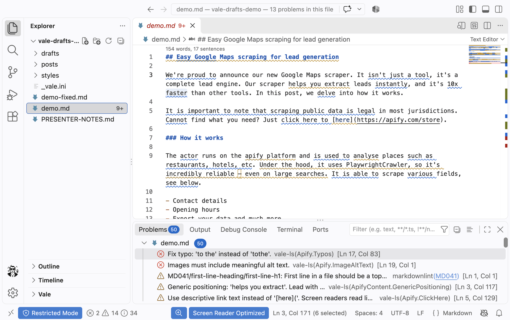
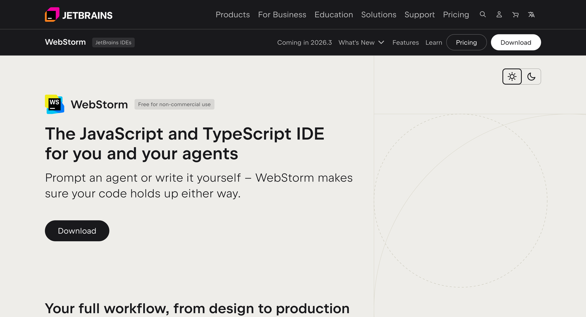
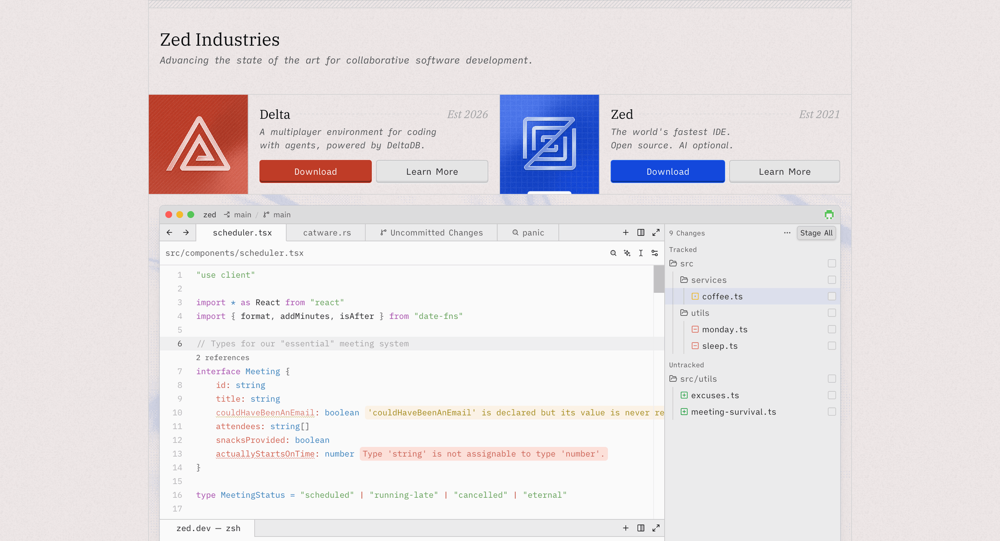
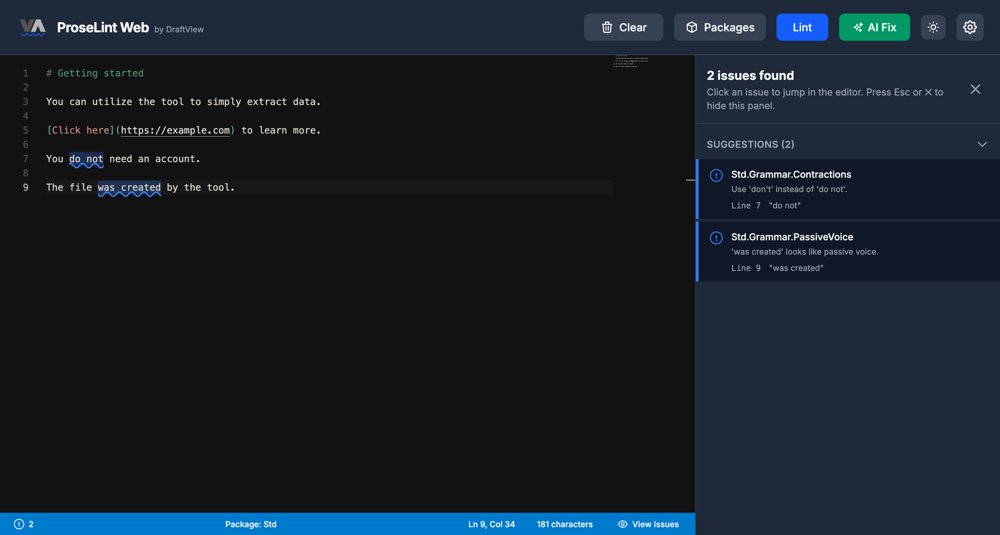
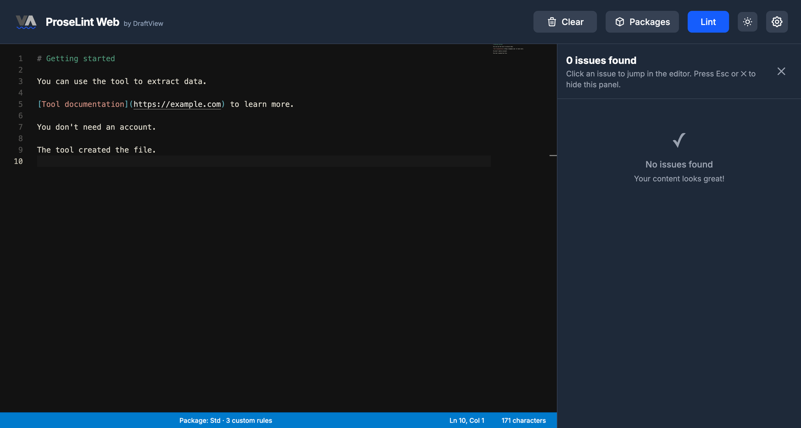
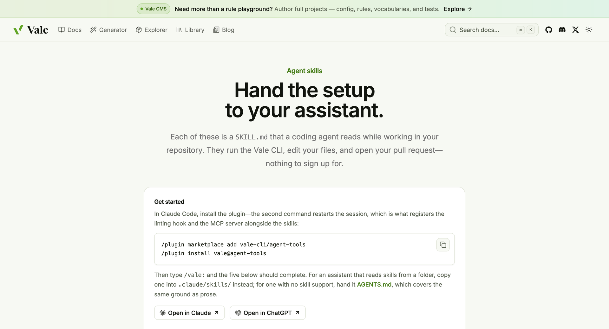

# Linting for everyone

**Marketing Q4 onsite, October 27, 2026**

Justin Gagne, Senior UX Writer<br>
`justin.gagne@apify.com`

---

## Linters check your writing against style rules

- Test and refine your style guide as you write.
- Make writing easier for more readers to understand.
- Keep Markdown structure consistent.

---

<!-- _class: screenshot -->

## A style guide can give feedback while you write



<small>Vale brings style-guide feedback into your editor.</small>

---

## We already had guardrails

Before AI agents, we relied on linters. **We still do.**

They turn agreed rules into consistent feedback.

---

## Consistent checks still need judgment

- The same text and rules give repeatable findings, including false positives.
- Zero findings means the enabled checks passed.
- People decide which suggestions improve the writing.

Review the writing. Refine the rules.

---

## Some rules ask a question

> Our scraper extracts leads instantly.

<small>`ApifyContent.UnverifiedPromise`</small>

> Possible claim-mismatch: ‘instantly’: verify this matches the actual user experience.

**Use evidence to decide: keep it, qualify it, or rewrite it.**

---

## Vale: a style guide that gives feedback

These checks reflect **Apify’s** editorial decisions.

| Our guidance | Before | Suggested revision |
| --- | --- | --- |
| Use official product names | apify console | Apify Console |
| Avoid assuming a mouse | Click on the Run button. | Select the Run button. |
| Make links descriptive | here | Apify Store |

<small>Apify Vale styles: [github.com/apify/vale-rules](https://github.com/apify/vale-rules)</small>

---

## Make the same instructions easier to read

**Before**

> Prior to initiating the extraction process, verify that the configuration parameters accurately reflect your requirements.

**After**

> Before you extract data, check that the settings match what you need.

**Vale can flag a passage’s reading level. You decide how to rewrite it.**

<small>Score the passage; review the wording. [docs.vale.sh/checks/readability](https://docs.vale.sh/checks/readability)</small>

---

## Check the Markdown structure, too

Markdown is plain text with headings, lists, links, and code.

**markdownlint** checks its structure and conventions.

| Before | After |
| --- | --- |
| `# Getting started` | `# Getting started` |
| `### How to set up the tool` | `## How to set up the tool` |

<small>markdownlint rule MD001: don’t skip heading levels.</small>

---

<!-- _class: editor-options -->

## Choose your text editor flavor

<div class="editor-grid">
<div>
<h3>VS Code</h3>
<p>Familiar, from Microsoft.</p>

<ul>
<li><a href="https://code.visualstudio.com/">code.visualstudio.com</a></li>
<li>Vale extension: <a href="https://marketplace.visualstudio.com/items?itemName=ChrisChinchilla.vale-vscode">marketplace.visualstudio.com/items?itemName=ChrisChinchilla.vale-vscode</a></li>
</ul>
</div>
<div>
<h3>WebStorm</h3>
<p>Local, from JetBrains.</p>

<ul>
<li><a href="https://www.jetbrains.com/webstorm/">jetbrains.com/webstorm</a></li>
<li>Vale plugin: <a href="https://plugins.jetbrains.com/plugin/19613-vale-cli">plugins.jetbrains.com/plugin/19613-vale-cli</a></li>
</ul>
</div>
<div>
<h3>Zed</h3>
<p>Lightweight, with GitHub Atom roots.</p>

<ul>
<li><a href="https://zed.dev/">zed.dev</a></li>
<li>Vale extension: <a href="https://zed.dev/extensions/vale">zed.dev/extensions/vale</a></li>
</ul>
</div>
</div>

---

<!-- _class: screenshot -->

## See both tools in your editor


<small>A deliberately flawed draft. Download: [editor-demo.zip](https://github.com/jgagne/linting-for-everyone/raw/refs/heads/main/editor-demo.zip)</small>

---

<!-- _class: screenshot -->

## Try a few rules in ProseLint Web



<small>Std (standard rules) suggests two edits: “do not” → “don’t” / “was created” → consider active voice.</small>

---

<!-- _class: screenshot -->

## Add two Apify rules


<small>4 findings. Our rules add “utilize” → “use” and descriptive link text.</small>

---

<!-- _class: screenshot -->

## Revise, then check again


<small>Zero findings with these checks. Is the writing finished?</small>

---

<!-- _class: screenshot -->

## One more rule, one more question


<small>“Simply” adds nothing here and can make the task sound easy for everyone.</small>

---

<!-- _class: screenshot -->

## Keep the meaning. Remove the filler.



<small>“You can use the tool to extract data.” All enabled checks pass.</small>

---

## A rule is a small, readable agreement

Match a product name and suggest its official spelling.

<small>`Apify.ApifyProductNames` (excerpt)</small>

```yaml
extends: substitution
message: "Use the Apify product name '%s' instead of '%s'."
ignorecase: true
level: warning
scope:
  - summary
  - heading
vocab: false
swap:
  'apify console': Apify Console
```

---

## A regex can express a writing rule

`[here](https://apify.com/store)` → `[Apify Store](https://apify.com/store)`

<small>`Apify.ClickHere`</small>

```regex
\[(?:[Cc]lick here|[Hh]ere|[Tt]his link|[Rr]ead more)\]\(
```

> Use descriptive link text. Screen readers read links out of context.

<small>See rule: [demo-rules/ClickHere.yml](https://github.com/jgagne/linting-for-everyone/blob/main/demo-rules/ClickHere.yml)</small>

---

## Choose your rules

1. Install Vale: [docs.vale.sh/topics/quickstart](https://docs.vale.sh/topics/quickstart)
2. Choose styles and generate `.vale.ini`: [vale.sh/generator](https://vale.sh/generator)
3. Save it in your project, then run `vale sync`.
4. Check a draft: `vale your-file.md`.

---

## The same checks, wherever you write

Commit the rules so people and agents share the same checks.

<small>Configure automated checks (CI) when you push changes. Run tools from the command line (CLI).</small>

| Place | Feedback loop |
| --- | --- |
| VS Code / WebStorm | Write → see findings → revise |
| CI | Push → run checks → review findings |
| Claude Code | Draft → run CLI → inspect findings → revise → rerun |

<small>[github.com/vale-cli/vale-action](https://github.com/vale-cli/vale-action) / [github.com/DavidAnson/markdownlint-cli2-action](https://github.com/DavidAnson/markdownlint-cli2-action)</small>

---

## Start with rules people trust

1. Agree on a few useful checks.
2. Test real drafts. Review false positives together.
3. Let only trusted checks block a merge.

---

## Give the agent a checkable task

The workflow must actually run the checks.

```text
Revise this draft using our project style guide.
Preserve meaning, facts, links, and code examples.
Run Vale and markdownlint with the project configuration;
fix clear issues and rerun both tools.
Flag suggestions that need judgment or evidence.
Show the diff and unresolved findings for human review.
```

**The agent revises. The tools check. A person decides.**

---

<!-- _class: screenshot -->

## Keep linters in your agent workflow



<small>Setup, fixes, triage, vocabulary, and CI. [vale.sh/skills](https://vale.sh/skills)</small>

---

## Try it in your workflow

Pick one recurring editorial comment. Turn it into a useful check.

- **Browser playground:** [proselintweb.com/editor](https://proselintweb.com/editor)
- **Adapted demo rules:** [github.com/jgagne/linting-for-everyone/tree/main/demo-rules](https://github.com/jgagne/linting-for-everyone/tree/main/demo-rules)
- **Apify Vale styles:** [github.com/apify/vale-rules](https://github.com/apify/vale-rules)
- **Check your Markdown:** [github.com/DavidAnson/markdownlint](https://github.com/DavidAnson/markdownlint)

---

## More resources

- **Set up Vale:** [docs.vale.sh/topics/quickstart](https://docs.vale.sh/topics/quickstart)
- **Explore styles and configure Vale:** [vale.sh/explorer](https://vale.sh/explorer) / [vale.sh/generator](https://vale.sh/generator)
- **Add markdownlint to VS Code:** [marketplace.visualstudio.com](https://marketplace.visualstudio.com/items?itemName=DavidAnson.vscode-markdownlint)
- **Run checks in CI:** [github.com/vale-cli/vale-action](https://github.com/vale-cli/vale-action) / [github.com/DavidAnson/markdownlint-cli2-action](https://github.com/DavidAnson/markdownlint-cli2-action)
- **Learn Markdown:** [markdownguide.org/getting-started](https://www.markdownguide.org/getting-started/)

